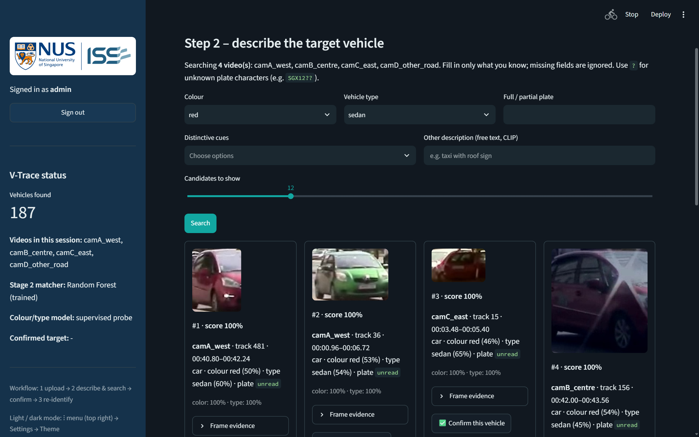
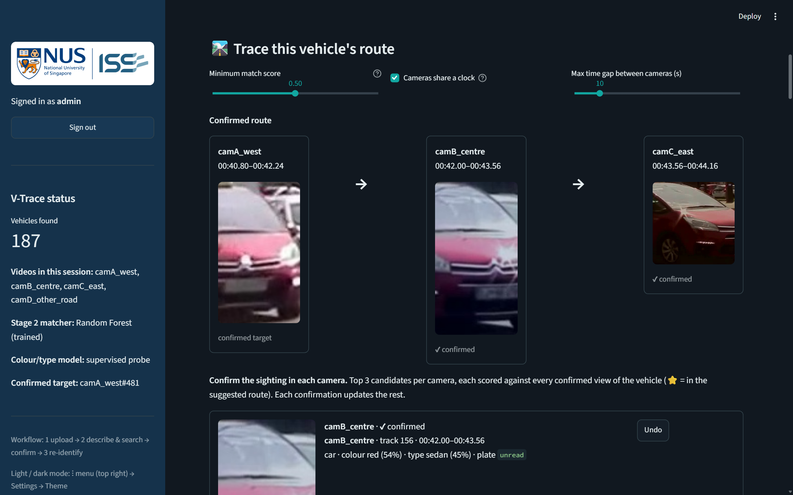
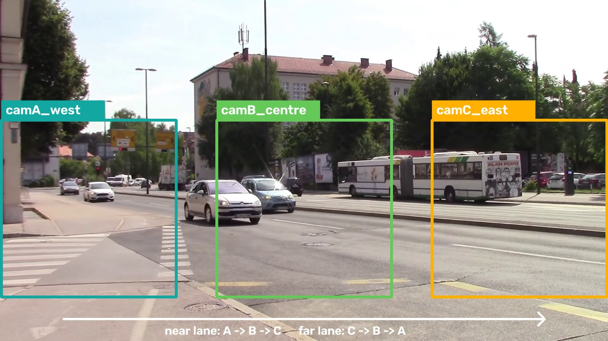
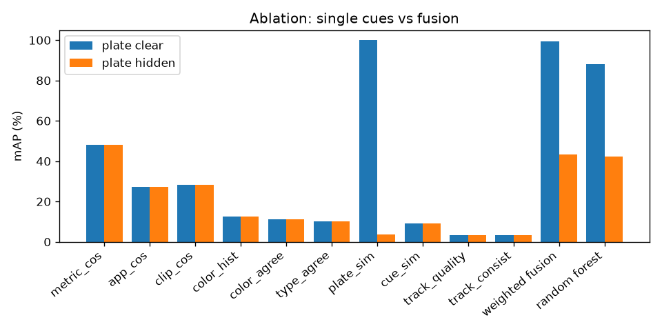
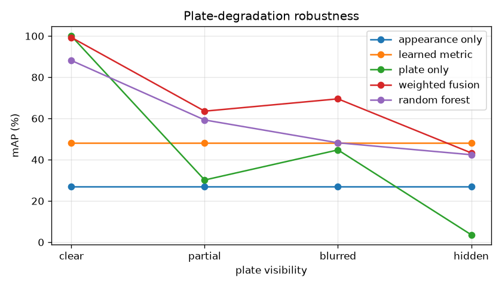
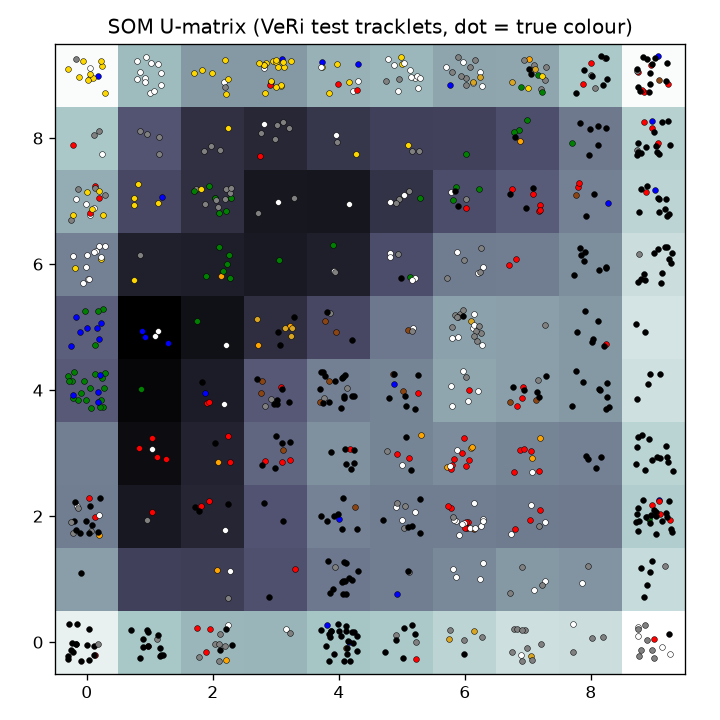
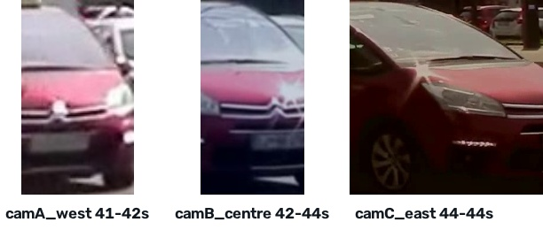
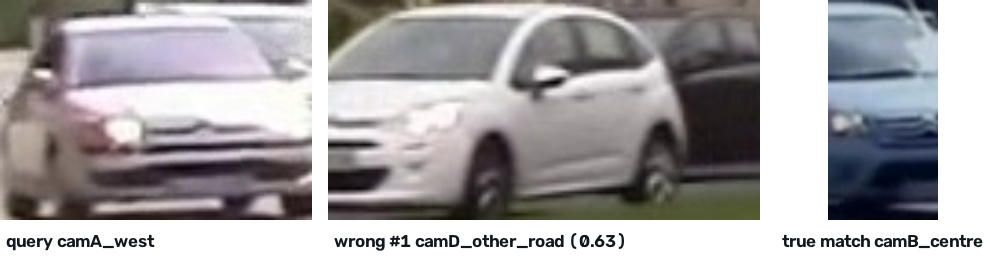

# V-Trace – Final Project Report

## Executive summary

V-Trace is a runnable pattern-recognition system for **multi-attribute vehicle search and cross-camera
re-identification (Re-ID)**. A user describes a vehicle with whatever is known (colour, type, a full or partial
licence plate, distinctive cues), V-Trace ranks the vehicles found in the uploaded camera videos, the user
**confirms** the right one, and V-Trace then re-identifies that vehicle in the other cameras and **traces its route**
camera by camera, with timestamps and frame evidence. Results are always ranked candidates for human review.

Key results:
- **Main hypothesis supported.** On VeRi-776, plate-only retrieval collapses from 100% to 3.6% mAP as plates degrade,
  while fused evidence stays well above appearance-only at every plate level (weighted fusion: 99 / 64 / 70 / 43 mAP
  for clear / partial / blurred / hidden plates, vs 27 for appearance only).
- **Supervised metric learning** (LDA on ResNet-50 + CLIP embeddings, trained on VeRi identities) is the single
  strongest cue: Rank-1 {{veri.metric.r1}}% and mAP {{veri.metric.map}}% with plates hidden, vs {{veri.app.r1}}% and {{veri.app.map}}% for
  the ImageNet embedding.
- **Description search** with colour + type + a partial plate puts the right vehicle in the top 5 for 84% of queries,
  and a supervised colour/type probe doubles type accuracy over zero-shot CLIP (38% → 79%).
- **Multi-camera demo footage.** The fused matcher reaches Rank-1 {{rf.Rank-1}}% (appearance only: {{app.Rank-1}}%).
  The automatic route suggestion is {{rf.route_precision}}% precise, and with one-click human confirmation per camera
  the right sighting is among the three shown for {{rf.camera_hit@3}}% of camera hops.
- All **four technique groups** are integrated in one Streamlit application with an admin sign-in.

## 1. Background and problem

Vehicle re-identification means deciding whether a vehicle seen by one camera is likely the same vehicle seen by
another. A licence plate is the strongest single identifier, but CCTV footage often can't read it: the plate may be too
small, blurred by motion, occluded, badly lit or facing away from the camera. Investigators also rarely start with a
clean image. They usually start with a partial description, such as "a white SUV, plate starting SGX12, dent on the
rear door".

V-Trace treats vehicle search as a **two-stage, multi-evidence pattern-recognition problem**. It uses the plate when the
plate is readable, but never depends on it alone, and it keeps a human confirmation step between the stages.

## 2. Objectives and scope

**Objective.** Build a runnable system that:
- processes uploaded traffic/CCTV videos, one video per camera;
- lets a user describe a target with whatever cues they have (colour, type, full or partial plate, distinctive cues, free text);
- returns ranked candidate vehicles;
- after the user confirms a candidate, re-identifies that vehicle across the other videos and traces its route, with video, timestamp and frame evidence.

| In scope | Out of scope |
|---|---|
| Uploaded multi-camera videos; detection; within-video tracking; tracklets | Operational live CCTV networks |
| Colour / type / plate / appearance / distinctive-cue descriptors | Vehicle-owner records |
| Description-based retrieval; human confirmation | Facial recognition of occupants |
| Metric learning, SOM, weighted fusion, Random Forest, cross-video Re-ID, route tracing | Definitive forensic identification |
| Ranked results with frames and timestamps in a Streamlit app | Training large detection / Re-ID networks from scratch |

The output is always a **ranked list for human review**, never an identity claim.

## 3. System design

```
Videos ─► YOLO11n detection ─► ByteTrack tracking ─► tracklets ─► descriptors ─► vehicle index (this session)
                                                                                        │
User description ─► Stage 1 ranked candidates ─► human CONFIRM ─► Stage 2 Re-ID ◄───────┘
                                       (learned metric · SOM pre-filter · weighted fusion / Random Forest)
                                                                     │
                       route tracing: suggested route + per-camera top-3 for human confirmation
                                                                     │
                                       ranked sightings + route + frames + timestamps
```

### 3.1 Video ingestion, detection and tracking (`vtrace/video.py`)
- Each uploaded video is treated as one camera.
- A pretrained **YOLO11n** detector (COCO classes car, motorcycle, bus, truck) runs on every *n*-th frame
  (speed presets: Fast = every 5th frame without OCR, Balanced = every 3rd, Detailed = every 2nd).
- **ByteTrack** links detections into tracks within each video. Tracks with fewer than 4 detections are discarded.
- For each **tracklet**, V-Trace keeps four high-quality crops spread out in time (quality = box area × confidence,
  halved at the frame edge), the box positions, and one annotated evidence frame with camera, track id and timestamp.
- Processed videos are cached with a signature (size, modification time, speed setting), so re-processing is instant.

### 3.2 Vehicle representation (`vtrace/features.py`, `vtrace/metric.py`)
Each tracklet is summarised by complementary descriptors averaged over its crops:

| Descriptor | Model | Role |
|---|---|---|
| Appearance embedding (2048-d) | ResNet-50, ImageNet-pretrained | generic visual cue |
| CLIP image embedding (512-d) | CLIP ViT-B/32 | second visual cue; basis for colour, type and cues |
| **Learned Re-ID embedding** | standardise [ResNet, CLIP] → PCA (256) → LDA, trained on VeRi-776 identities | main Re-ID cue |
| Colour & type probabilities | supervised linear probe on CLIP embeddings (VeRi labels); CLIP zero-shot fallback | description search; attribute agreement |
| HSV colour histogram (16×4×4) | hand-crafted | colour similarity |
| Distinctive-cue scores | CLIP text–image similarity over a controlled vocabulary (roof rack, spoiler, dent, decal, roof cargo) | optional supporting evidence |
| Plate text | EasyOCR on the largest crops, kept only when confidently read | strong evidence when available |
| Track consistency | mean cosine of crops to the tracklet centroid | track-level reliability |

The ImageNet and CLIP embeddings describe "a car" well but were never trained to tell two cars apart. **Linear
Discriminant Analysis** learns, from labelled vehicle identities, a projection that keeps the directions separating
identities and suppresses within-identity variation such as viewpoint, scale and lighting. It is cheap (a linear map
on stored embeddings), so existing indexes need no reprocessing.

No single descriptor is required. A missing descriptor lowers confidence but never blocks a search.

### 3.3 Stage 1 – description-to-vehicle retrieval (`vtrace/search.py`)
- Each field the user provides gets a score in [0, 1]: colour and type probability; wildcard-aware plate similarity
  (`?` = unknown character, partial plates match any part of the plate); CLIP cue and free-text scores.
- The final score is a weighted mean **over the provided fields only**. A tracklet whose plate could not be read gets
  a neutral plate score rather than zero, so it is not excluded.
- Only the videos processed in the current session are searched.

### 3.4 Stage 2 – confirmed-candidate cross-camera Re-ID (`vtrace/reid.py`)
The confirmed tracklet becomes the visual query. For every tracklet in the other videos, V-Trace computes an
11-dimensional pairwise evidence vector: learned-metric cosine; ResNet cosine; CLIP cosine; colour-histogram
intersection; colour and type agreement; plate similarity and a flag for whether both plates were read; cue agreement;
track quality and track consistency. Four scorers are compared:
1. **Appearance only** (baseline): ResNet-50 cosine.
2. **Learned metric** (supervised baseline): cosine in the LDA space.
3. **Weighted fusion** (transparent): fixed weights; the plate weight is used only when both plates were read.
4. **Random Forest** (ensemble): 300 trees, class-balanced, monotonic constraints, trained on labelled same/different-vehicle pairs.

When the cameras share a clock, an optional **time window** (default 10 s) drops candidates too far in time from the query.

### 3.5 Route tracing (`reid.trace_path`, `reid.camera_candidates`)
Following one vehicle through several cameras is done in two layers.

**Suggested route (automatic).** The path grows greedily from the confirmed sighting. Every camera's candidates are
scored against **all** sightings already on the path (the best score counts), so a camera in between bridges a far,
small view and a near, large view of the same car. A camera's best candidate joins only if it scores at least 0.5
**and** beats that camera's runner-up by a margin of 0.1. This ambiguity test, similar in spirit to Lowe's ratio test,
leaves two similar cars close in time for the human to decide. The strongest such camera joins first, and the rest
are re-scored.

**Human confirmation per camera (interactive).** For each other camera the app shows the top three candidates,
marking the suggested one. One click confirms the right sighting. Each confirmation joins the set of known views of
the vehicle, and every remaining camera is re-scored against all of them. This keeps the human-in-the-loop principle
of Stage 1 for every hop of the route.

### 3.6 Unsupervised SOM (`vtrace/som.py`)
Appearance embeddings are reduced with PCA (32-d) and mapped onto a Self-Organizing Map (grid size by the 5√N
heuristic). No identity labels are used. The SOM is used to (a) visualise groups of similar vehicles (U-matrix) and
(b) optionally pre-filter Re-ID candidates to map nodes near the query's best-matching unit.

### 3.7 Streamlit application (`app.py`)
- **Admin sign-in**: username and password from Streamlit secrets or environment variables; constant-time comparison; the app stays locked if no account is configured.
- **Theme**: the proposal deck's teal/navy palette in dark (default) and light modes.
- **Tabs**: 1 Upload & process videos (with a one-click demo); 2 Describe & search (Stage 1, with a Confirm button per
  candidate); 3 Confirm & re-identify (route tracing, per-camera confirmation, then all ranked candidates with their
  evidence vectors and frames); Track review (manual tracking check); SOM; Evaluation (benchmark results).





## 4. Technique group mapping

| Technique group | Implementation in V-Trace | Evidence |
|---|---|---|
| 1. Supervised / unsupervised learning | LDA metric learning on vehicle identities; Random Forest same/different matcher; colour/type linear probe; unsupervised SOM (+ PCA) | learned metric vs ImageNet Re-ID; probe vs zero-shot accuracy; SOM purity and pre-filter recall |
| 2. Machine / deep learning | YOLO11n detector, ResNet-50 embeddings, CLIP vision-language model, EasyOCR | appearance-only Rank-1/5, mAP; attribute accuracy |
| 3. Hybrid / ensemble | Random Forest and weighted fusion over 11 evidence features vs single cues | ablation; plate-degradation robustness |
| 4. Intelligent sensing / sense-making | raw video → detections → tracks → tracklets → descriptors → candidates → confirmed target → route | end-to-end Streamlit demo; demo-camera evaluation |

## 5. Data and experimental protocol

### 5.1 VeRi-776 benchmark
**VeRi-776** (Liu et al.) has more than 50,000 images of 776 vehicles from 20 cameras, with colour and type labels.
- Images of the same vehicle in the same camera are consecutive frames of one pass, so they are grouped into
  **tracklets**, the same unit the video pipeline produces. Four images are sampled evenly per tracklet.
- Training uses identities from `image_train`; testing uses identities from `image_test`. The sets are
  **identity-disjoint**, which prevents data leakage.
- Subset: **150 training vehicles (1,290 tracklets)** and **100 test vehicles (830 tracklets)**, chosen at random (seed 0).

**Re-ID protocol.** Each test tracklet is a query (300 queries); the gallery is every test tracklet from other cameras;
a match is relevant if it has the same vehicle id. Metrics: Rank-1, Rank-5, mAP.

**Learned models.** The colour/type probes and the LDA metric are fitted on the training vehicles. The Random Forest
is trained on 6,000 positive pairs (same vehicle, different camera) and 18,000 negatives, half random and half *hard*
(same predicted colour and type). Every learned input to the forest (colour/type probabilities and LDA projections)
comes from **out-of-fold** models (5-fold `GroupKFold` by vehicle), so its training features are as noisy as at test
time, and the forest uses **monotonic constraints** (a higher similarity can never lower the score). Section 7
explains both choices.

**Plate robustness.** VeRi has no plate text, so each identity gets a synthetic Singapore-style plate, degraded per
observation at four levels: *clear* (occasional single OCR slip), *partial* (about 45% of characters unknown),
*blurred* (about 45% confusable substitutions, sometimes a dropped character) and *hidden* (no plate). The RF is
trained on a mixture of all levels and tested at each level separately.

### 5.2 Multi-camera demo footage
The end-to-end demo uses a 46 s, 1080p street recording from Ljubljana (Wikimedia Commons, CC BY 3.0; see
`docs/DEMO_DATA.md`). About thirty vehicles cross the whole frame in 5–10 s, so the frame is cut into **three
non-overlapping camera zones along the road**, with gaps between them and a different exposure, colour cast and
sharpness per zone (Figure 3). A car on the near lane is seen in camA, then camB, then camC; a car on the far lane in
the reverse order. Along the way its scale and viewpoint really change, which makes cross-camera matching non-trivial.
A fourth camera (camD) shows a different road and acts as a distractor: its vehicles never appear in A–C.



**Demo evaluation (pseudo ground truth).** Because the three cameras come from one recording, the uncropped clip is
tracked once at high resolution (YOLO11n + ByteTrack, every 2nd frame, 1280 px) and every camera tracklet is mapped
back onto it by box overlap (IoU > 0.3, majority vote). This gives a reference identity per tracklet without manual
labelling. It is *pseudo* ground truth: it inherits the reference tracker's own mistakes. It is used to measure
tracking quality, cross-camera Re-ID and route tracing on the demo cameras (`scripts/demo_eval.py`). The 10 s time
window and the 0.5 / 0.1 route thresholds are the app's defaults and were not tuned on these results.

## 6. Results

### 6.1 Attribute recognition (accuracy %, 830 VeRi test tracklets)
{{table.attributes}}

The supervised probe roughly doubles type accuracy. Zero-shot CLIP confuses sedan, hatchback and estate.

### 6.2 Stage 1 – description search (query = a test vehicle's true attributes)
{{table.description}}

Each cue alone is weak, but together they put the right vehicle in the top 5 for 84% of queries. That is what Stage 1
needs: a short list for the human to confirm from.

### 6.3 Stage 2 – Re-ID ablation, plates hidden (VeRi-776)
{{table.ablation}}

**Metric learning is the largest single gain**: the LDA projection lifts Rank-1 from {{veri.app.r1}}% to {{veri.metric.r1}}% and
mAP from {{veri.app.map}}% to {{veri.metric.map}}% over the same ImageNet embedding, using only 150 training vehicles. Colour, type
and cues are too coarse to rank on their own.



### 6.4 Plate-degradation robustness (mAP %, VeRi-776)
{{table.plates}}



Plate-only retrieval collapses as plates degrade (100 → 3.6 mAP). The fused methods stay far above appearance-only at
every level, which **supports the main hypothesis**. The transparent weighted fusion is now the best fusion at every
level. With plates hidden, however, the learned metric *alone* beats both fusions (48.0 vs 43.3 mAP): colour and type
are already encoded in the learned embedding, so adding the probes' imperfect attribute agreement mostly adds noise.

### 6.5 SOM (10×10, unsupervised)
- **Purity:** vehicle ID {{som.id}}, colour {{som.colour}}, type {{som.type}}. The map organises vehicles by **type and colour**, not identity.
- **As a pre-filter** (plates hidden, Random Forest):

{{table.som}}



The pre-filter removes 70–94% of candidates but loses too many true matches, so it lowers accuracy. This is a useful
negative result: the SOM is good for visual exploration, but at this scale it shouldn't filter Re-ID candidates.

### 6.6 Tracking quality on the demo cameras
Against the reference tracks (Section 5.2), **{{tracking.clean_tracklets_%}}%** of the camera tracklets are *clean*
(at least 95% of their boxes belong to one reference vehicle; mean purity {{tracking.mean_purity}}). On average a
vehicle produces **{{tracking.tracklets_per_vehicle_per_camera}}** tracklets per camera (1.0 would mean no
fragmentation), and {{tracking.unmapped_tracklets_%}}% of tracklets could not be mapped reliably (for example parked or
heavily occluded vehicles). The demo cameras contain {{tracklets_total}} tracklets in total
({{tracklets_by_camera}}); {{vehicles_in_2plus_cameras}} reference vehicles appear in at least two of cameras A–C and
{{vehicles_in_all_3}} in all three.

### 6.7 Cross-camera Re-ID and route tracing on the demo cameras
Every mapped tracklet in cameras A–C that has a true match in another of those cameras is a query ({{rf.queries}}
queries); the gallery is all other cameras, including the distractor camD. *Route precision* is the share of suggested
route steps that are correct; *route recall* is the share of the vehicle's true cameras the suggestion finds;
*camera hit@k* is the share of true camera hops whose correct sighting is among the top *k* shown for that camera
(scored against the query only, before any confirmation).

With the 10 s time window (cameras share a clock):

{{table.demo}}

Without a time window:

{{table.demo_nowindow}}



On this footage the **fused scorers beat both appearance-only and the learned metric alone**, unlike on VeRi with hidden plates. Colour, type and the
HSV histogram reject look-alike vehicles of the wrong colour or body type, and the zones' different colour casts make
the learned metric alone less reliable. The time window helps every method (Random Forest Rank-1 {{rfnw.Rank-1}}% → {{rf.Rank-1}}%).

The automatic route suggestion is deliberately **conservative**: when it adds a camera it is usually right, but it
finds only about a quarter of the true cameras on its own, for example when a vehicle is small or partly occluded
in one zone. This is why the interface shows the top three per camera. The right sighting is among them for about
two thirds of camera hops, and confirming one camera re-scores the others: for the silver car in camA (track 1), the
true camC sighting is outside the top three when scored against the camA view alone, and becomes the #1 candidate
once its camB sighting is confirmed.

## 7. Discussion and failure analysis

**Leak-free stacking.** The Random Forest's training pairs first used colour/type probabilities from a probe fitted on
the *same* training vehicles. On those vehicles the attributes were near-perfect, so the forest relied on colour/type
agreement (combined importance 0.33), and on unseen vehicles it ranked worse than appearance alone (hidden plates,
Rank-1 38 vs 59 at the time). Out-of-fold probabilities fixed this. The same rule was applied to the LDA metric: in-sample
projections would make same-vehicle training pairs look unrealistically similar.

**Monotonic constraints.** VeRi has large viewpoint changes, and the unconstrained forest learned splits where
*higher* similarity could *lower* the score. Monotonic constraints fixed this (hidden plates: mAP 21 → 30 before metric
learning). Caveat: this choice came from a diagnostic on test queries, so the RF-vs-fusion comparison is indicative,
not a tuned final number.

**Learned vs hand-set fusion.** After metric learning, the forest gives the learned-metric cosine most of its
importance ({{imp.metric_cos}}), followed by plate similarity ({{imp.plate_sim}}) and colour agreement ({{imp.color_agree}}),
yet the transparent weighted fusion matches or beats it at every plate level, by a wide margin with blurred plates
(69.5 vs 48.2 mAP) and with clear plates (99.3 vs 88.1). The forest learns from a balanced pair set, so it
optimises *same vs different classification*, not *ranking within one gallery*. A ranking objective (learning-to-rank,
or per-query calibration) and a separate validation split for model choice are the clear next steps. For a system
whose users must understand the scores, the transparent fusion is a strong default.

**Benchmark vs real footage.** The best method depends on the data: the learned metric alone is best on VeRi with
hidden plates, while fusion is best on the demo footage, where colour casts and small, distant vehicles make any single
cue less reliable. This is an argument for keeping several evidence sources and a human in the loop rather than
trusting one score.

**Observed failure modes on the demo footage**
- **Scale and viewpoint change:** a vehicle seen small and front-on in one zone and large and side-on in another gives
  dissimilar embeddings; confirming the middle camera bridges many of these cases.
- **Look-alike vehicles and colour casts:** in Figure 8 a silver Citroën in camA is matched to a similar white Citroën on
  the distractor road (score {{fail.score}}), while the true match in camB looks bluish because of that camera's colder
  colour cast.
- **Track fragmentation and occlusion:** buses occlude cars in the far lane and the zone edges cut vehicles, splitting one
  vehicle into several tracklets ({{tracking.tracklets_per_vehicle_per_camera}} per vehicle per camera).
- **Attribute errors:** CLIP-based type labels confuse estate, hatchback and MPV; colour is unreliable for silver/grey.
- **No plates:** none were readable at this camera distance. This is exactly the setting V-Trace targets.



## 8. Limitations and future work
- The LDA metric is linear and trained on only 150 vehicles. Training on all 576 VeRi training identities, or
  fine-tuning the backbone with a triplet loss, is the clearest accuracy gain.
- The plate experiment uses synthetic plate strings, and OCR runs on whole-vehicle crops. Real plate data and a
  dedicated plate detector before OCR would strengthen the plate evidence.
- The Random Forest optimises pair classification; learning-to-rank and a validation split for model choice are next.
- The three demo cameras are zones of one recording, not separate physical cameras; a multi-camera dataset such as
  CityFlow (data-use request required) would be a stronger test. Learned travel-time distributions between camera
  pairs would replace the fixed time window.
- The pipeline reads files but works frame by frame, so live RTSP streams are a small change.

## 9. Conclusion
V-Trace starts from incomplete information about a vehicle, retrieves likely candidates, keeps a human confirmation
step, and then re-identifies and traces the confirmed vehicle across the remaining cameras using several complementary
sources of evidence. On VeRi-776, plate-only retrieval collapses from 100% to 3.6% mAP as plates degrade, while
multi-evidence fusion stays far above appearance-only throughout, and supervised metric learning nearly doubles the mAP
of the generic embedding. Description search with colour, type and a partial plate puts the right vehicle in the top 5
for 84% of queries. On real multi-camera footage, fusion beats appearance-only and the learned metric alone, and route tracing combines a
conservative automatic suggestion with one-click human confirmation per camera. The SOM reveals type/colour structure
but is not a reliable candidate filter, and a learned fusion needs care (leak-free features, monotonic constraints)
and is not automatically better than a transparent one.

## References
- Liu, X., Liu, W., Mei, T., & Ma, H. (2016). A Deep Learning-Based Approach to Progressive Vehicle Re-identification for Urban Surveillance (VeRi-776). ECCV.
- Zhang, Y. et al. (2022). ByteTrack: Multi-Object Tracking by Associating Every Detection Box. ECCV.
- Radford, A. et al. (2021). Learning Transferable Visual Models From Natural Language Supervision (CLIP). ICML.
- He, K. et al. (2016). Deep Residual Learning for Image Recognition (ResNet). CVPR.
- Fisher, R. A. (1936). The Use of Multiple Measurements in Taxonomic Problems (linear discriminant analysis). Annals of Eugenics.
- Lowe, D. G. (2004). Distinctive Image Features from Scale-Invariant Keypoints (ratio test). IJCV.
- Kohonen, T. (1990). The Self-Organizing Map. Proceedings of the IEEE.
- Breiman, L. (2001). Random Forests. Machine Learning.
- Jocher, G. et al. Ultralytics YOLO11 and multi-object tracking documentation. https://docs.ultralytics.com/
- Sounds of Changes. Road traffic in Ljubljana (video), Wikimedia Commons, CC BY 3.0.

## Appendix A – Running the system
1. Install (Windows, Python 3.11): `python -m venv .venv`, then `.venv\Scripts\pip install -r requirements.txt`.
2. Create the admin account: copy `.streamlit/secrets.toml.example` to `.streamlit/secrets.toml` and set a username and password.
3. Run `.venv\Scripts\python -m streamlit run app.py`, open http://localhost:8501 and sign in.
4. Demo footage: place the two Commons clips in `data/videos/raw/` and run `python scripts/prepare_demo_clips.py`; in the app, tab 1 → **Quick demo**.
5. Benchmark: download VeRi-776 (request from the authors), then run `python scripts/train_eval.py` and `python scripts/demo_eval.py`.

Step-by-step demo scenarios and a guide for assessors are in `docs/DEMO_GUIDE.md`.

## Appendix B – Deliverables
| Deliverable | Location |
|---|---|
| Runnable system (source code, tests, CI) | `app.py`, `vtrace/`, `scripts/`, `tests/` |
| Trained models | `models/metric_lda.joblib`, `models/rf_matcher.joblib`, `models/attr_probe.joblib` |
| Datasets | demo cameras (`data/videos/`, built by `scripts/prepare_demo_clips.py`); VeRi-776 by request from its authors |
| Results | `results/metrics.json`, `results/tables.md`, `results/demo_eval.json`, figures |
| Final report | this document |
| Presentation slides | `V-Trace_First_Presentation.pptx`, `V-Trace_Final_Presentation.pptx` |
| Demo guide | `docs/DEMO_GUIDE.md` |

## AI declaration
In preparing this project, AI-based tools including Claude, ChatGPT and Gemini were used to support drafting and
refining text, organising content, implementation and general research support. All ideas, analysis, technical
design decisions and conclusions are the work of the project team.
