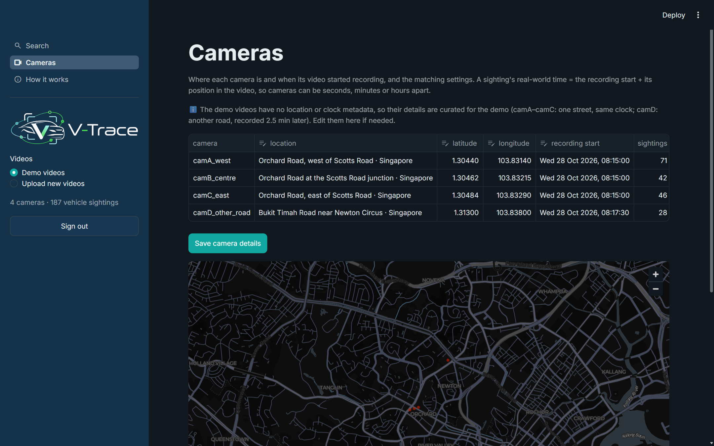

# V-Trace – Final Project Report

| Member | Student ID | Responsibility |
|---|---|---|
| Gurneet Kaur Bhuller (Group 21, one-person team) | A0354164E | Problem framing, system design, pipeline, matching logic, evaluation, application, report, presentations, video |

Repository: https://github.com/GurneetKB/V-Trace (private; access on request)

## Executive Summary

Traffic and dash-cam footage is recorded by many cameras, but finding one vehicle in it is slow: an investigator
usually starts from a description ("a red SUV, plate starting SGX…"), and the plate is often unreadable. **V-Trace**
is a pattern-recognition platform that answers two questions: *which recorded vehicles fit this description?* and,
once the user has picked the right one, *where else, and when, was the same vehicle seen?*

The user loads short videos – demo cameras already on the platform, or new uploads – and V-Trace turns each video into
**sightings**: every vehicle is detected, followed while it stays in view and described. A description returns a
**ranked list of best matches**; when the user selects one, V-Trace shows **every camera the vehicle was seen in, with
the camera's location, the real-world date and time, and a frame from each sighting**, plus the route in time order.

V-Trace is built entirely from **published, pretrained models**: YOLO11 and ByteTrack for sightings, CLIP for zero-shot
description scoring, EasyOCR for plates, and the **FastReID model trained on VeRi-776 by the VeRi authors' team** for
cross-camera re-identification. Nothing was trained for this project.

Key results:
- The Re-ID model reproduces its published accuracy on the official VeRi-776 split: **Rank-1 {{veri.rank1}}%, mAP
  {{veri.mAP}}%** (published: 97.0% / 81.9%).
- On real street footage it is much weaker (Rank-1 {{demo.Rank-1}}%), so the decision rule matters: a ratio test and a
  real-world time window raise the share of correct cameras reported from {{demo.precision_thr}}% to
  **{{demo.camera_precision}}%**, without any training.
- One Streamlit application with an admin sign-in covers the whole flow, with a demo set and an upload test pack.

## 1. Business Problem Background

### 1.1 Context
Road and traffic cameras are everywhere in a modern city: LTA publishes live images from traffic cameras on Singapore's
expressways and major roads, red-light and speed cameras enforce traffic rules, and many vehicles carry dash cams. After
an incident – a hit-and-run, a stolen car, a vehicle of interest – investigators need to know where a vehicle went.
Today this is largely manual: watching hours of footage from several cameras and comparing vehicles by eye.

### 1.2 The problem
Three gaps make the search hard:
- **The plate is often unreadable.** At street distance, at night, in motion blur or from behind, the plate is too
  small or hidden. In our demo footage not a single plate was readable.
- **The search starts from a description, not an image.** "A red SUV with a roof rack" is incomplete and uncertain.
- **Each camera sees the car briefly, from its own angle.** The same car looks different in two cameras (scale,
  viewpoint, lighting), and two different cars of the same model can look almost identical.

### 1.3 Users and value
The intended user is an analyst or investigator (traffic police, an operator of a camera network, a fleet or car-park
operator). V-Trace gives them a ranked shortlist instead of hours of footage, the camera, location and real-world time
of every sighting, and the evidence (frames, scores, closest alternatives) to check each result. It is a decision aid:
the output is always a ranked list for human review, never an identity claim.

## 2. Market Research and Literature Review

### 2.1 Vehicle re-identification
Vehicle Re-ID matches images of the same vehicle across cameras. **VeRi-776** (Liu et al., 2016) – 50,000+ images of
776 vehicles from 20 surveillance cameras – became the standard benchmark, together with VehicleID and the CityFlow
multi-camera dataset of the AI City Challenge (Tang et al., 2019). Strong baselines combine a ResNet-50 backbone, a
BN-neck and identity plus metric losses (Luo et al., 2019, "Bag of Tricks"); instance-batch normalisation (IBN-Net, Pan
et al., 2018) and non-local blocks improve robustness to appearance changes. **FastReID** (He et al., 2020), released by
JD AI Research – the team of the VeRi-776 authors – packages these into a toolbox and publishes trained models; its
SBS(R50-ibn) model reaches Rank-1 97.0% and mAP 81.9% on VeRi-776.

### 2.2 Description-based retrieval
Searching vehicles by natural language was the topic of AI City Challenge Track 5 (2021). Vision-language models
such as **CLIP** (Radford et al., 2021) score an image against arbitrary text, so colour, type and distinctive features
can be scored **zero-shot**, without labelled training data. Licence-plate recognition is mature for close, frontal
views; general OCR engines such as EasyOCR read plates when they are large enough.

### 2.3 Detection and tracking
Single-stage detectors (the YOLO family, here YOLO11 from Ultralytics) detect vehicles in real time, and
tracking-by-detection methods such as **ByteTrack** (Zhang et al., 2022) link detections of one vehicle across frames,
including low-confidence detections, which keeps tracks through partial occlusion.

### 2.4 Current practice and gap
Commercial video-analytics platforms offer vehicle search in large deployments, and research code exists for each
component, but we found no simple, open tool that takes a handful of ordinary video files, lets a user search by
description and then shows where and when the selected vehicle reappears, with the evidence for each result. V-Trace
fills that gap by connecting published components into one workflow and adding a cautious, explainable decision rule.

## 3. Project Objectives and Success Measurements

**Objective.** Build a basic, working vehicle Re-ID platform that offers demo or uploaded videos, processes each video
into sightings, ranks sightings against a description, and after the user selects one, shows every camera it was seen
in with location, real-world time and a frame. Live camera networks, owner records, facial recognition and training
detection or Re-ID networks are out of scope.

| Stage | Measure | Answer key | Target | Result |
|---|---|---|---|---|
| Re-ID model | Rank-1 / mAP on VeRi-776 | Official query/test split | Within 1 point of the published 97.0 / 81.9 | {{veri.rank1}} / {{veri.mAP}} ✔ |
| Threshold | Share of true / wrong pairs above the threshold | VeRi-776 pairs | ≥ 85% true, ≤ 1% wrong | {{veri.keep_same}}% / {{veri.keep_diff}}% ✔ |
| Re-ID on footage | Rank-1, Rank-5, mAP across cameras | Pseudo ground truth (Section 6.2) | reported | {{demo.Rank-1}} / {{demo.Rank-5}} / {{demo.mAP}} |
| Where seen | Cameras reported that are correct | Pseudo ground truth | ≥ 70% | {{demo.camera_precision}}% ✔ |
| Where seen | Distractor road wrongly reported | Pseudo ground truth | ≤ 10% of queries | {{demo.false_camD}}% ✔ |
| Search | The demo vehicle in the top 5 for its description | Demo scenario | top 5 | #3 ✔ |
| Uploads | Processing time per clip (Fast) | 20–22 s test clips, laptop CPU | ≤ clip length × 1.5 | about 1× ✔ |
| Software | Unit and end-to-end tests | Synthetic data + demo bundle | all pass | all pass ✔ |

## 4. Project Solution: System Design

### 4.1 Inputs and outputs
**Input:** one or more videos (one video = one camera), each with a location and a recording start; a description of
the vehicle (any of colour, type, plate with `?` wildcards, distinctive features, free text). **Output:** the ranked
best-matching sightings; for the selected one, every camera where the same vehicle was seen with location, real-world
date and time span, position in the video, a crop and a full frame, the route in time order and a map; and, for
cameras with no confident match, the three closest vehicles.

### 4.2 Architecture

```
Videos ─► YOLO11n detection ─► ByteTrack tracking ─► sightings ─► descriptors ─► vehicle index
                                                                   │
            FastReID VeRi-776 embedding · CLIP zero-shot colour/type/features · EasyOCR plate
                                                                   │
Description ─► ranked best matches ─► user SELECTS one ─► same vehicle in every camera ─► location + real time + frame
                                                   ▲
              camera details: location + recording start  (real-world time = recording start + position in the video)
```

### 4.3 Design principles
1. **Pretrained only.** Every model is a published checkpoint used unchanged; our work is integration, decision logic
   and evaluation.
2. **A person decides.** V-Trace ranks and shows evidence; ambiguous cases are shown as candidates, not decided.
3. **Real-world context.** Every sighting carries the camera's location and a real-world time, so results read as
   "Orchard Road at Scotts Road, 08:15:42" rather than "video 2 at 00:42".

### 4.4 Choice of techniques

| Step | Chosen | Alternatives considered | Reason |
|---|---|---|---|
| Detection | YOLO11n (COCO vehicle classes) | Larger YOLO models, Faster R-CNN | Fast enough on a CPU for upload-and-search; vehicles are a standard COCO class |
| Tracking | ByteTrack | DeepSORT, BoT-SORT | Ships with Ultralytics; keeps low-confidence boxes, so fewer broken tracks |
| Cross-camera Re-ID | FastReID SBS(R50-ibn), VeRi-776 | ImageNet ResNet-50 or CLIP embeddings; training our own metric | Trained on vehicle identities by the dataset's authors; 97% Rank-1, against about 60% for generic ImageNet embeddings in our earlier tracklet-level tests |
| Colour, type, features | CLIP ViT-B/32 zero-shot | Classifiers trained on VeRi labels | No training needed; also handles free text |
| Plate | EasyOCR on the lower part of the largest crops | Dedicated plate detector + recogniser | General, pretrained; plates are evidence only when confidently read |
| Same-vehicle decision | Best sighting per camera + threshold + ratio test + real-world time window | Threshold alone | Threshold alone reported mostly wrong cameras on real footage (Section 6.3) |

### 4.5 Data model
A **sighting** (tracklet) stores its camera, first/last/best time in the video, boxes, four crops spread in time, one
annotated full frame, and its descriptors (Re-ID embedding, CLIP embedding, colour/type/feature probabilities, plate).
A **camera** stores its location (name, optional latitude/longitude) and recording start. Real-world times are derived
when the view is built, so editing a camera's details never touches the processed sightings.

## 5. System Development and Implementation

### 5.1 Technology and engineering practice
Python 3.11, PyTorch 2.5 (CPU), Ultralytics (YOLO11 + ByteTrack), open_clip, EasyOCR, OpenCV and Streamlit 1.66. The
code (`vtrace/` package, `app.py`, `scripts/`) was developed on GitHub with one branch and pull request per change,
unit tests on synthetic sightings and an end-to-end test of the demo flow (`streamlit.testing.AppTest`), run by GitHub
Actions.

### 5.2 Videos → sightings (`vtrace/video.py`)
Every 3rd frame (every 5th with *Fast processing*) goes through YOLO11n; ByteTrack links the detections of one vehicle.
One track is one sighting: its time span, boxes, four good crops spread over time (large, confident, not cut by the frame
edge) and one full frame with the vehicle boxed. Tracks with fewer than 4 detections are dropped as noise.

### 5.3 Camera details and real-world time (`vtrace/cameras.py`)
A video file knows only positions in the video. Each camera therefore has a location and a **recording start**; a
sighting's real-world time is the recording start plus its position in the video, so two cameras can be seconds,
minutes or hours apart, and the route is ordered by real-world time. For uploads the user enters the details next to
each video; all details can be edited on the *Cameras* page. The demo and test videos carry no such metadata, so their
details are **curated** and placed in Singapore (table below).

| Camera | Location (curated) | Recording start (curated) |
|---|---|---|
| camA_west | Orchard Road, west of Scotts Road | Wed 28 Oct 2026, 08:15:00 |
| camB_centre | Orchard Road at the Scotts Road junction | Wed 28 Oct 2026, 08:15:00 |
| camC_east | Orchard Road, east of Scotts Road | Wed 28 Oct 2026, 08:15:00 |
| camD_other_road | Bukit Timah Road near Newton Circus | Wed 28 Oct 2026, 08:17:30 |

### 5.4 Describing each sighting (`vtrace/features.py`, `vtrace/fastreid.py`)
- **Re-ID embedding.** Each crop goes through the FastReID VeRi-776 network (ResNet-50 with IBN-a and non-local blocks,
  GeM pooling, BN-neck; 256×256 input); the embeddings are averaged and L2-normalised. FastReID is a large training
  framework, so `vtrace/fastreid.py` only re-declares the network so that the published checkpoint loads with plain
  PyTorch; the weights (downloaded on first use) are used unchanged.
- **Colour and type.** CLIP compares the averaged crop embedding with prompts such as "a photo of a red car" (ten VeRi
  colours, nine VeRi types).
- **Distinctive features and free text.** CLIP scores prompts such as "a photo of a car with a rear spoiler" against
  the neutral "a photo of a car".
- **Plate.** EasyOCR reads the lower part of the two largest crops; a plate is kept only if confidently read.

### 5.5 Description → ranked matches (`vtrace/search.py`)
Each field the user fills in gives every sighting a 0–1 score: colour and type (CLIP probability relative to the most
likely value), plate (wildcard-aware similarity; unread plates get a neutral 0.3), features and free text (CLIP prompt
scores). The final score is the weighted mean over only the fields given (plate 0.35, colour 0.30, type 0.25, features
0.10, text 0.10), so a missing field never counts against a vehicle.

### 5.6 Selected match → where it was seen (`vtrace/reid.py`)
The similarity of two sightings is the cosine of their FastReID embeddings. For every other camera, the most similar
sighting is reported as the same vehicle only if (1) its similarity is at least **0.40**, chosen from the VeRi-776 score
distributions; (2) it beats the camera's second-best sighting by at least **0.08** – a ratio test, as in Lowe's SIFT
matching, so look-alike cars are left to the user; and (3) with the time limit on, it is within **10 s** of the selected
sighting in real-world time (adjustable from 5 s to 12 h).

### 5.7 The application (`app.py`)
An admin sign-in (credentials in Streamlit secrets, compared in constant time) protects the app, which opens in dark mode
with the V-Trace logo. The sidebar chooses **Demo videos** or **Upload new videos** (location and start time per file)
and *Sign out*. The **Search** page has three steps: *1 Describe the vehicle*, *2 Best matches*
(crop, camera, real-world time, location, colour/type, score, **Select**) and *3 Where this vehicle was seen* (route with
real-world times and the time between cameras, one row per sighting with location, date and time, crop and frame, a map,
and the closest vehicles for cameras with no confident match). The **Cameras** page lists and edits every camera's
location and recording start and holds the matching settings; **How it works** lists the models and benchmark results.




## 6. Experiments

### 6.1 The Re-ID model on VeRi-776 (`scripts/eval_veri.py`)
Each of the {{veri.queries}} query images is ranked against the {{veri.gallery}} test images; gallery images of the same
vehicle from the same camera are ignored (standard protocol). Nothing was trained.

| Metric | Our run | FastReID model zoo |
|---|---|---|
| Rank-1 | {{veri.rank1}}% | 97.0% |
| Rank-5 | {{veri.rank5}}% | – |
| mAP | {{veri.mAP}}% | 81.9% |

Same-vehicle pairs from different cameras have a median similarity of {{veri.same50}} (10th percentile
{{veri.same10}}), while 99% of different-vehicle pairs score below {{veri.diff99}}. At the threshold of 0.40,
{{veri.keep_same}}% of same-vehicle pairs and {{veri.keep_diff}}% of different-vehicle pairs pass.

### 6.2 Demo cameras (`scripts/demo_eval.py`)
The demo uses a 46 s, 1080p street recording (Wikimedia Commons, CC BY 3.0) cut into **three non-overlapping camera
zones along the road**, each with its own exposure and colour cast, so a car passes A → B → C or C → B → A; a fourth
camera shows another road whose vehicles never appear in A–C (Figure 4). Processing gives {{demo.tracklets_total}}
sightings ({{demo.tracklets_by_camera}}). Tracking the uncropped clip once at high resolution and mapping each zone
sighting back onto it by box overlap gives a reference identity per sighting (*pseudo* ground truth: it inherits the
reference tracker's mistakes). {{demo.vehicles_in_2plus_cameras}} vehicles appear in two or more cameras and
{{demo.vehicles_in_all_3}} in all three; {{demo.clean}}% of sightings follow one vehicle only.


Over {{demo.queries}} queries (sightings whose vehicle also appears in another camera), the correct sighting in another
camera is ranked first for **{{demo.Rank-1}}%** (Rank-5 {{demo.Rank-5}}%, mAP {{demo.mAP}}%) – far below the benchmark.

### 6.3 Decision-rule ablation

| Rule for "seen in this camera" | Cameras reported correct | Cameras found | Queries wrongly placed on the other road |
|---|---|---|---|
| Best sighting above 0.40 | {{demo.precision_thr}}% | {{demo.recall_thr}}% | {{demo.false_camD_thr}}% |
| + ratio test (beats the 2nd best by 0.08) | {{demo.precision_nw}}% | {{demo.recall_nw}}% | {{demo.false_camD_nw}}% |
| + real-world time window of 10 s (final) | **{{demo.camera_precision}}%** | {{demo.camera_recall}}% | {{demo.false_camD}}% |

The ratio test doubles precision by refusing ambiguous cameras; the time window removes physically impossible matches.
Part of the window's gain comes from the curated clocks: the other road is recorded 2.5 minutes later, so a 10 s window
rules it out completely. The cost of caution is recall: for cameras without a confident match the user sees the
closest candidates instead.

### 6.4 Upload test pack (`test_videos/`)
Seven 20–22 s clips (two sets of three Orchard Road cameras and one Bukit Timah Road camera) were processed as an upload
with *Fast processing* (about 1 s of processing per second of video on a laptop CPU). Against the same pseudo ground
truth, 71% (set 1) and 75% (set 2) of the cameras reported are correct, about a third of the true cameras are found, and
no query is placed on Bukit Timah Road. Verified scenarios are listed in `test_videos/README.md`.

## 7. Findings and Discussion

### 7.1 Findings
- **Published models are strong – on their own data.** The FastReID model reproduces its benchmark result, but on
  street footage with small, distant vehicles and new angles, Rank-1 falls from 97% to {{demo.Rank-1}}%.
- **The decision rule matters as much as the model.** A threshold alone reports mostly wrong cameras; a ratio test and
  real-world time make the reported cameras mostly right, with no training.
- **Context makes results usable.** Location, real-world time, time between cameras and a frame per sighting turn
  scores into evidence a person can check.

### 7.2 What did not work, and what we changed
- **Generic embeddings and our own learned metric.** An earlier version used ImageNet ResNet-50 and CLIP embeddings with
  a metric (LDA) and a Random Forest trained on VeRi; it reached about 77% Rank-1 on VeRi at best and needed training. The
  published FastReID model replaced it: stronger, and nothing to train.
- **Threshold alone** placed {{demo.false_camD_thr}}% of queries on the distractor road; the ratio test and time window
  fixed most of this.
- **Video time instead of real time.** Comparing positions in different videos assumed all cameras started together;
  camera recording starts now make the time window meaningful for cameras minutes or hours apart.

### 7.3 Limitations
- The demo and test cameras are zones of one recording, and their Singapore locations and times are curated.
- Plates are rarely readable at street distance; colour and type from zero-shot CLIP confuse similar classes
  (silver/grey/white; estate/hatchback/MPV).
- Small or briefly seen vehicles may be dropped by tracking (especially with *Fast processing*) or not matched.
- The pseudo ground truth inherits the reference tracker's own errors.

### 7.4 Future work
- Test on separate physical cameras (e.g. CityFlow), and learn travel times between camera locations instead of one
  fixed window.
- Add a dedicated plate detector before OCR, and higher-resolution crops for distant vehicles.
- Read camera locations and clocks directly from the camera system or video metadata; process live streams.

## 8. Conclusion
V-Trace shows that a useful vehicle search and re-identification platform can be assembled from published pretrained
models: YOLO11 and ByteTrack turn video into sightings, CLIP and EasyOCR make them searchable by description, and the
FastReID VeRi-776 model links the selected vehicle across cameras. The model reproduces its published accuracy
(mAP {{veri.mAP}}%), and on real street footage a cautious decision rule with real-world time makes
{{demo.camera_precision}}% of the reported cameras correct, while locations, times and frames let a person check every
result.

## References
- Liu, X., Liu, W., Mei, T., & Ma, H. (2016). A Deep Learning-Based Approach to Progressive Vehicle Re-identification for Urban Surveillance (VeRi-776). ECCV.
- He, L., Liao, X., Liu, W., Liu, X., Cheng, P., & Mei, T. (2020). FastReID: A Pytorch Toolbox for General Instance Re-identification. arXiv:2006.02631. https://github.com/JDAI-CV/fast-reid
- Luo, H., Gu, Y., Liao, X., Lai, S., & Jiang, W. (2019). Bag of Tricks and a Strong Baseline for Deep Person Re-identification. CVPR Workshops.
- Pan, X., Luo, P., Shi, J., & Tang, X. (2018). Two at Once: Enhancing Learning and Generalization Capacities via IBN-Net. ECCV.
- Tang, Z. et al. (2019). CityFlow: A City-Scale Benchmark for Multi-Target Multi-Camera Vehicle Tracking and Re-Identification. CVPR.
- Zhang, Y. et al. (2022). ByteTrack: Multi-Object Tracking by Associating Every Detection Box. ECCV.
- Radford, A. et al. (2021). Learning Transferable Visual Models From Natural Language Supervision (CLIP). ICML.
- Lowe, D. G. (2004). Distinctive Image Features from Scale-Invariant Keypoints. IJCV.
- Jocher, G. et al. Ultralytics YOLO11 and multi-object tracking documentation. https://docs.ultralytics.com/
- JaidedAI. EasyOCR. https://github.com/JaidedAI/EasyOCR
- Sounds of Changes. Road traffic in Ljubljana (videos), Wikimedia Commons, CC BY 3.0.

## Appendix A – Project Proposal and Changes

| Proposal | Delivered | Reason |
|---|---|---|
| Describe → search → confirm → re-identify across uploaded videos | Unchanged: describe → rank → select → where seen | – |
| Appearance embeddings fused with colour, type, plate and track cues by a trained Random Forest; SOM pre-filter | Pretrained FastReID VeRi-776 embedding with a threshold, ratio test and time window | The published model is far stronger and needs no training; the learned fusion did not beat it |
| Supervised colour/type classifiers trained on VeRi | CLIP zero-shot colour/type/features | No training; also handles free text |
| Timestamps in video time | Camera location + recording start → real-world time | Cameras recorded at different times; results readable as place and time |
| Evaluation on VeRi-776 | VeRi-776 official split + demo footage + upload test pack | Measures both the model and the platform |

## Appendix B – Mapped System Functionalities against Course Knowledge

| Course area | Where it appears in V-Trace | How it is demonstrated |
|---|---|---|
| Pattern recognition and machine learning systems | Supervised metric learning (FastReID trained on VeRi identities) applied to new footage; similarity threshold chosen from score distributions | VeRi-776 benchmark (6.1), threshold analysis |
| Deep learning / computer vision | YOLO11 detection, IBN-ResNet Re-ID network, CLIP vision-language model, OCR | Search and Where seen pages |
| Intelligent sensing and sense-making | Video → detections → tracks → sightings → descriptors → ranked matches → where seen, with real-world time and location | Demo and upload test pack (6.2–6.4) |
| Problem solving with pattern recognition | Multi-evidence description search (fields weighted by what is given); decision rule with ratio test and time window | Decision-rule ablation (6.3) |

## Appendix C – Installation and User Guide

**C.1 Requirements.** Windows, macOS or Linux, Python 3.11. A GPU is optional.

**C.2 Install and run.**
1. `python -m venv .venv`, then `.venv\Scripts\pip install -r requirements.txt` (Windows).
2. Copy `.streamlit/secrets.toml.example` to `.streamlit/secrets.toml` and set the admin username and password.
3. `.venv\Scripts\python -m streamlit run app.py` and open http://localhost:8501. The pretrained weights download on first use.

**C.3 Using the application.**
1. Sign in. The four demo cameras are already processed.
2. *Describe the vehicle* (e.g. Colour **red**, Type **suv**) and click **Search**.
3. In *Best matches*, click **Select** on the vehicle (in the demo: #3, Orchard Road at Scotts Road, 08:15:42.0).
4. *Where this vehicle was seen* shows the route (Orchard Road west 08:15:40.8 → Scotts Road 08:15:42.0 → east 08:15:43.5),
   each sighting's location, date and time, crop and frame, and a map.
5. To try uploads, choose **Upload new videos** and add a set from `test_videos/` (details fill in automatically), or
   your own clips with their location and start time.
6. Edit camera locations and recording starts on the **Cameras** page; the threshold and time limit are there too.

**C.4 Deployment and access.** The app deploys on Streamlit Community Cloud from the repository (`app.py`, Python 3.11,
the `[admin]` block in Secrets). The hosted link and the assessor sign-in are provided with the Canvas submission.

**C.5 Video.** The 10–15 minute presentation video is submitted with this report (`V-Trace_Presentation.mp4`).

## Appendix D – Individual Project Report
The individual report is submitted separately (`V-Trace_Individual_Report_Gurneet_Kaur_Bhuller`).

## Appendix E – Use of AI Tools
AI-based tools including Claude, ChatGPT and Gemini were used in a supporting role: drafting and refining text,
organising content, coding assistance whose output was reviewed and tested before it was merged, and general research
support. All ideas, analysis, technical design decisions and conclusions are the work of the project team.

## Appendix F – Abbreviations

| Term | Meaning |
|---|---|
| Re-ID | Re-identification: recognising the same vehicle in another camera |
| Sighting / tracklet | All frames in which one vehicle is seen continuously in one camera |
| VeRi-776 | Vehicle Re-ID benchmark of 776 vehicles from 20 cameras |
| Rank-1 / Rank-5 | Share of queries whose correct match is first / in the top 5 |
| mAP | Mean average precision over all queries |
| CLIP | Contrastive Language–Image Pre-training (vision-language model) |
| IBN | Instance-batch normalisation |
| OCR | Optical character recognition |
