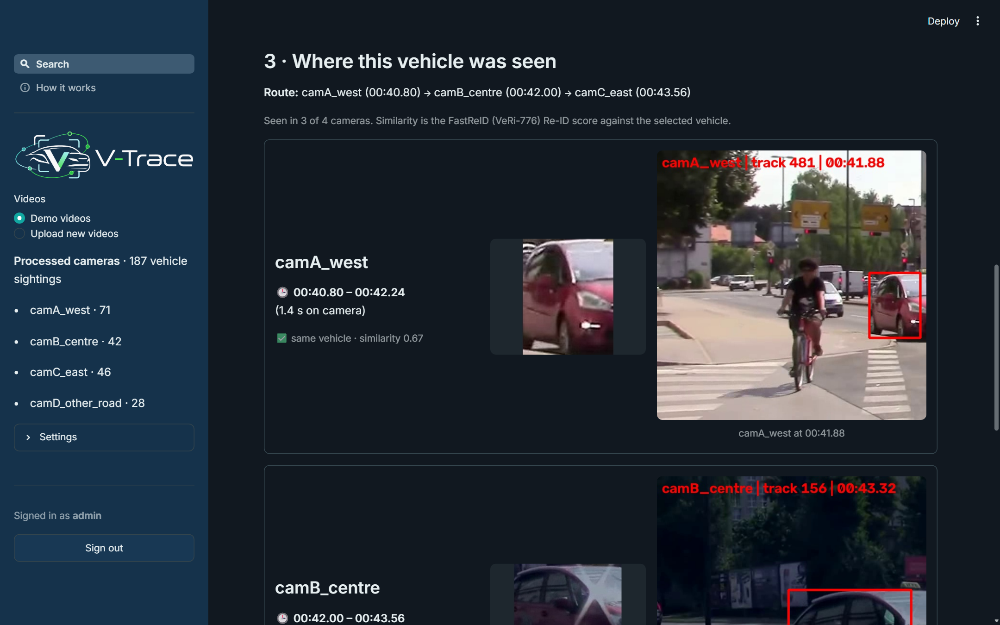

# V-Trace – Final Project Report

## Executive summary

V-Trace is a runnable pattern-recognition system for **vehicle search and cross-camera re-identification (Re-ID)**.
The user loads short dash-cam or traffic-camera videos, either the demo videos already on the platform or new uploads,
and V-Trace processes each video into *sightings*: every vehicle is detected, followed while it stays in view, and
described. The user then describes the vehicle they are looking for (colour, type, full or partial licence plate,
distinctive features, free text). V-Trace returns a **ranked list of best matches**. When the user selects one, V-Trace
shows **every camera the vehicle was seen in, with the time span and one frame from each sighting**.

The system is built entirely from **published, pretrained models**. Nothing is trained for this project:
YOLO11 detects vehicles, ByteTrack follows them, CLIP scores the description zero-shot, EasyOCR reads plates, and the
**FastReID VeRi-776 model** released by the VeRi-776 authors' team (JDAI-CV) matches vehicles across cameras.

Key results:
- **The Re-ID model as published, on the official VeRi-776 split:** Rank-1 {{veri.rank1}}%, Rank-5 {{veri.rank5}}%,
  mAP {{veri.mAP}}% ({{veri.queries}} queries, {{veri.gallery}} gallery images; FastReID reports 97.0% / 81.9%).
- **On the demo cameras** (real street footage, {{demo.tracklets_total}} sightings in four cameras): the correct sighting
  of the same vehicle in another camera is ranked first for {{demo.Rank-1}}% of queries (Rank-5 {{demo.Rank-5}}%,
  mAP {{demo.mAP}}%). At the default threshold, **{{demo.camera_precision}}% of the cameras V-Trace reports are correct**
  and it finds {{demo.camera_recall}}% of the cameras the vehicle really passed through.
- One Streamlit application with an admin sign-in covers the whole flow: videos → describe → ranked matches → select →
  where it was seen.

## 1. Background and problem

Vehicle re-identification means deciding whether a vehicle seen by one camera is the same vehicle seen by another. A
licence plate is the strongest single identifier, but in traffic footage it is often unreadable: too small, blurred,
occluded, badly lit or facing away. Investigators also rarely start with an image. They start with a description, such
as "a red sedan with a spoiler, plate starting SGX12".

V-Trace therefore works in two steps. First, a **description search** turns what the user knows into a ranked list of
sightings. Second, once the user has picked the right sighting, **image-based Re-ID** finds the same vehicle in every
other camera, without needing the plate.

## 2. Objectives and scope

**Objective.** Build a basic, working vehicle Re-ID platform that:
- offers two inputs: demo videos already on the platform, or new short uploaded videos (one video = one camera);
- processes each video and groups the frames in which one vehicle is seen continuously into one **sighting**
  (e.g. a red sedan visible for 4 s in camera 1);
- takes a description of the target (colour, type, plate, distinctive features, free text) and returns ranked best matches;
- after the user selects a match, shows every camera in which that vehicle was seen, with the time span and one frame
  from each sighting.

| In scope | Out of scope |
|---|---|
| Short uploaded or bundled videos; detection; tracking; sightings | Live CCTV networks |
| Colour / type / plate / distinctive-feature description search | Vehicle-owner records, facial recognition |
| Cross-camera Re-ID with a pretrained model; ranked results with frames and timestamps | Training detection or Re-ID networks |

The output is always a **ranked list for a person to review**, never an identity claim.

## 3. System design

```
Videos ─► YOLO11n detection ─► ByteTrack tracking ─► sightings ─► descriptors ─► vehicle index
                                                                   │
            FastReID VeRi-776 embedding · CLIP zero-shot colour/type/features · EasyOCR plate
                                                                   │
Description ─► ranked best matches ─► user SELECTS one ─► same vehicle in every camera ─► time span + frame
```

| Step | Model (pretrained, used as published) | Source |
|---|---|---|
| Detect vehicles | YOLO11n, COCO classes car / motorcycle / bus / truck | Ultralytics |
| Follow a vehicle while it is in view | ByteTrack | Ultralytics |
| Colour, type, distinctive features, free text | CLIP ViT-B/32, zero-shot | OpenAI (open_clip) |
| Licence plate | EasyOCR | JaidedAI |
| Same vehicle in another camera | FastReID SBS(R50-ibn), trained on VeRi-776 | JDAI-CV/fast-reid |

### 3.1 Videos → sightings (`vtrace/video.py`)
Every 3rd frame (every 5th in *Fast processing*) goes through YOLO11n; ByteTrack links the detections of one vehicle
over time. One track is one **sighting**: the vehicle's camera, its first and last time, its boxes, four good crops
spread over time, and one full frame with the vehicle boxed (the frame where its crop is largest and sharpest).
Tracks shorter than 4 detections are dropped as noise.

### 3.2 Describing each sighting (`vtrace/features.py`, `vtrace/fastreid.py`)
- **Re-ID embedding.** Each crop goes through the FastReID VeRi-776 network (ResNet-50 with IBN-a and non-local blocks,
  GeM pooling, BN-neck; 256×256 input); the four 2048-d embeddings are averaged and L2-normalised. FastReID is a large
  training framework, so `vtrace/fastreid.py` only re-declares the network so that the published checkpoint loads with
  plain PyTorch; the weights are used unchanged.
- **Colour and type.** CLIP compares the averaged crop embedding with prompts such as "a photo of a red car" or
  "a photo of a sedan car" (ten VeRi colours, nine VeRi types) and keeps the softmax probabilities.
- **Distinctive features and free text.** CLIP scores prompts such as "a photo of a car with a rear spoiler" against
  the neutral "a photo of a car".
- **Plate.** EasyOCR reads the lower part of the two largest crops; a plate is kept only if it is confidently read.

### 3.3 Description → ranked matches (`vtrace/search.py`)
Each field the user fills in gives every sighting a 0–1 score: colour and type (the CLIP probability of the requested
value, relative to the most likely value), plate (wildcard-aware similarity; `?` = unknown character; a sighting whose
plate could not be read gets a neutral 0.3), distinctive features and free text (CLIP prompt scores). The final score is
the weighted mean over **only the fields provided** (plate 0.35, colour 0.30, type 0.25, features 0.10, text 0.10), so a
missing field never counts against a vehicle. The 12 best sightings are shown.

### 3.4 Selected match → where it was seen (`vtrace/reid.py`)
The similarity of two sightings is the cosine of their FastReID embeddings. For the selected sighting, V-Trace checks
every other camera and takes that camera's most similar sighting. It is reported as the same vehicle only if
- its similarity is at least **0.40** (chosen from the VeRi-776 score distributions, Section 5.1);
- it beats the camera's second-best sighting by at least **0.08**. This is a ratio test (as in Lowe's SIFT matching):
  when two vehicles are almost equally similar, the answer is ambiguous and is left to the user;
- when the videos were recorded at the same time (the demo cameras), it is within **10 s** of the selected sighting.

Each reported sighting is shown with its camera, time span, a crop and the full frame, and the route lists them in time
order. For cameras with no confident match, the three closest vehicles are shown so the user can judge. All three
settings can be changed in the app; uploaded videos are assumed to be recorded at different times (no time window).

### 3.5 Streamlit application (`app.py`)
An admin sign-in (credentials in Streamlit secrets, compared in constant time) protects the app. The sidebar chooses
**Demo videos** or **Upload new videos** (with a *Fast processing* switch) and lists the processed cameras. The Search
page has three steps: *1 Describe the vehicle*, *2 Best matches* (cards with crop, camera, time span, colour/type,
plate, score and **Select**), *3 Where this vehicle was seen* (route, then one row per sighting with time span, crop and
frame). A *How it works* page lists the models and the benchmark numbers. The app opens in dark mode with the V-Trace
logo and palette. The demo cameras are bundled pre-processed (`demo_bundle/`) so the hosted app loads them instantly.




## 4. Technique group mapping

| Technique group | In V-Trace |
|---|---|
| **Machine / deep learning** | Pretrained deep models: YOLO11 detector, FastReID Re-ID network, CLIP, EasyOCR |
| **Supervised learning** | The FastReID model is a supervised metric-learning model (trained by its authors on VeRi-776 identities with softmax + triplet losses); we apply it to new footage |
| **Hybrid / multi-evidence** | Description search combines colour, type, plate, feature and free-text evidence with weights that adapt to the fields given |
| **Intelligent sensing / sense-making** | Raw video → detections → tracks → sightings → descriptors → ranked matches → selected vehicle → sightings across cameras |

## 5. Evaluation

### 5.1 The Re-ID model on VeRi-776
**VeRi-776** (Liu et al., 2016) has more than 50,000 images of 776 vehicles from 20 cameras. We ran the published
checkpoint on the **official split**: each of the {{veri.queries}} query images is ranked against the {{veri.gallery}}
test images; gallery images of the same vehicle from the same camera are ignored (standard protocol). Nothing was trained.

| Metric | Our run | FastReID model zoo |
|---|---|---|
| Rank-1 | {{veri.rank1}}% | 97.0% |
| Rank-5 | {{veri.rank5}}% | – |
| mAP | {{veri.mAP}}% | 81.9% |

**Choosing the threshold.** Same-vehicle pairs from different cameras have a median similarity of {{veri.same50}}
(10th percentile {{veri.same10}}), while 99% of different-vehicle pairs score below {{veri.diff99}}. At the default
threshold of 0.40, {{veri.keep_same}}% of same-vehicle pairs and {{veri.keep_diff}}% of different-vehicle pairs pass.

### 5.2 Demo cameras
The demo uses a 46 s, 1080p street recording from Ljubljana (Wikimedia Commons, CC BY 3.0). The frame is cut into
**three non-overlapping camera zones along the road** (camA_west, camB_centre, camC_east), each with a different
exposure and colour cast, so a car on the near lane passes A → B → C and a car on the far lane C → B → A. A fourth
camera (camD_other_road) is a different road whose vehicles never appear in A–C.


Processing gives {{demo.tracklets_total}} sightings ({{demo.tracklets_by_camera}}). Because the three street cameras
come from one recording, tracking the uncropped clip once at high resolution and mapping every zone sighting back onto it
by box overlap gives a reference identity per sighting without manual labelling (*pseudo* ground truth: it inherits the
reference tracker's own mistakes). {{demo.vehicles_in_2plus_cameras}} vehicles appear in two or more cameras and
{{demo.vehicles_in_all_3}} in all three.

| Measure (`scripts/demo_eval.py`) | Value |
|---|---|
| Queries (sightings whose vehicle also appears in another camera) | {{demo.queries}} |
| Rank-1 / Rank-5 / mAP, other cameras only | {{demo.Rank-1}}% / {{demo.Rank-5}}% / {{demo.mAP}}% |
| Cameras reported that are correct (precision), with / without the 10 s window | {{demo.camera_precision}}% / {{demo.precision_nw}}% |
| Cameras passed through that are reported (recall), with / without the window | {{demo.camera_recall}}% / {{demo.recall_nw}}% |
| Queries wrongly reported in the distractor camera camD, with / without the window | {{demo.false_camD}}% / {{demo.false_camD_nw}}% |

**Why the decision rule matters.** With a similarity threshold alone (every sighting above it reported), only about
40% of the reported cameras were correct and more than half of the queries were wrongly placed on the distractor road.
Keeping only each camera's best sighting, adding the ratio test and the time window raised precision to
{{demo.camera_precision}}% without any training. The cost is recall: for cameras without a confident match the user
sees the closest candidates instead.
| Sightings that follow one vehicle only (tracking purity ≥ 95%) | {{demo.clean}}% |

## 6. Discussion and failure analysis

**Benchmark vs real footage.** The model is excellent on VeRi-776, the data it was trained for, and clearly weaker on
the demo footage, which comes from a different city, camera height and resolution: many vehicles are small (60–150 px)
and seen from very different angles in neighbouring zones. This domain gap is the main reason for keeping a person in
the loop: V-Trace shows its evidence (frames, time spans, scores, and the closest candidate where nothing passed the
threshold) rather than making an identity claim.

**Observed failure modes**
- **Scale and viewpoint change:** a vehicle seen small and front-on in one zone and large and side-on in another gives
  lower similarity and can fall below the threshold.
- **Look-alike vehicles:** silver and white compact cars are common; a similar car can pass the threshold.
- **Track fragmentation and switches:** buses occlude cars in the far lane and the zone edges cut vehicles, splitting one
  vehicle into several sightings; occasionally a track switches between two cars.
- **Attribute errors:** CLIP zero-shot confuses estate, hatchback and MPV, and silver vs grey vs white.
- **No plates:** none were readable at this camera distance, which is exactly why image-based Re-ID is needed.

## 7. Limitations and future work
- The demo cameras are zones of one recording, not separate physical cameras; a multi-camera dataset such as CityFlow
  would be a stronger test.
- Learned travel times between camera pairs would replace the fixed 10 s window.
- A dedicated plate detector before OCR would make plate evidence usable at longer distances.
- The pipeline reads files frame by frame, so live streams are a small change.

## 8. Conclusion
V-Trace shows that a useful vehicle search and Re-ID platform can be assembled from published pretrained models:
YOLO11 + ByteTrack turn video into sightings, CLIP and EasyOCR make them searchable by description, and the FastReID
VeRi-776 model links the selected vehicle across cameras. The model reproduces its published accuracy on VeRi-776
(mAP {{veri.mAP}}%), and on real street footage it reports the right cameras with {{demo.camera_precision}}% precision,
while the frames and time spans let a person check every result.

## References
- Liu, X., Liu, W., Mei, T., & Ma, H. (2016). A Deep Learning-Based Approach to Progressive Vehicle Re-identification for Urban Surveillance (VeRi-776). ECCV.
- He, L., Liao, X., Liu, W., Liu, X., Cheng, P., & Mei, T. (2020). FastReID: A Pytorch Toolbox for General Instance Re-identification. arXiv:2006.02631. https://github.com/JDAI-CV/fast-reid
- Pan, X., Luo, P., Shi, J., & Tang, X. (2018). Two at Once: Enhancing Learning and Generalization Capacities via IBN-Net. ECCV.
- Zhang, Y. et al. (2022). ByteTrack: Multi-Object Tracking by Associating Every Detection Box. ECCV.
- Radford, A. et al. (2021). Learning Transferable Visual Models From Natural Language Supervision (CLIP). ICML.
- Jocher, G. et al. Ultralytics YOLO11 and multi-object tracking documentation. https://docs.ultralytics.com/
- JaidedAI. EasyOCR. https://github.com/JaidedAI/EasyOCR
- Sounds of Changes. Road traffic in Ljubljana (video), Wikimedia Commons, CC BY 3.0.

## Appendix A – Running the system
1. Install (Windows, Python 3.11): `python -m venv .venv`, then `.venv\Scripts\pip install -r requirements.txt`.
2. Create the admin account: copy `.streamlit/secrets.toml.example` to `.streamlit/secrets.toml` and set a username and password.
3. Run `.venv\Scripts\python -m streamlit run app.py`, open http://localhost:8501 and sign in. The pretrained weights download on first use.
4. Benchmark: download VeRi-776 from its authors, then run `python scripts/eval_veri.py`; demo evaluation: `python scripts/demo_eval.py`.

Step-by-step demo scenarios and a guide for assessors are in `docs/DEMO_GUIDE.md`.

## Appendix B – Deliverables
| Deliverable | Location |
|---|---|
| Runnable system (source code, tests) | `app.py`, `vtrace/`, `scripts/`, `tests/` |
| Pretrained models | downloaded on first use (FastReID VeRi-776 checkpoint into `models/`) |
| Datasets | demo cameras (`demo_bundle/`, built by `scripts/prepare_demo_clips.py`); VeRi-776 by request from its authors |
| Results | `results/veri_eval.json`, `results/demo_eval.json` |
| Final report | this document |
| Presentation slides | `V-Trace_First_Presentation.pdf`, `V-Trace_Final_Presentation.pptx` |
| Demo guide | `docs/DEMO_GUIDE.md` |

## AI declaration
In preparing this project, AI-based tools including Claude, ChatGPT and Gemini were used to support drafting and
refining text, organising content, implementation and general research support. All ideas, analysis, technical
design decisions and conclusions are the work of the project team.
